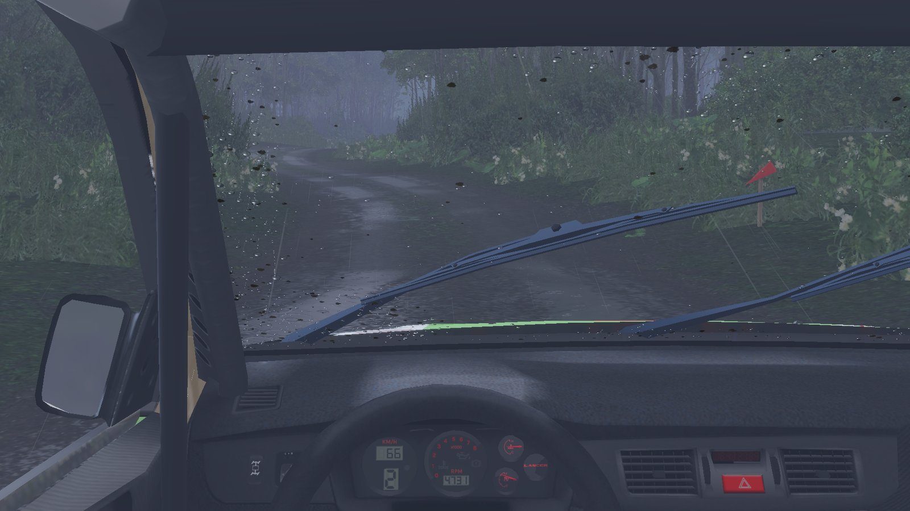
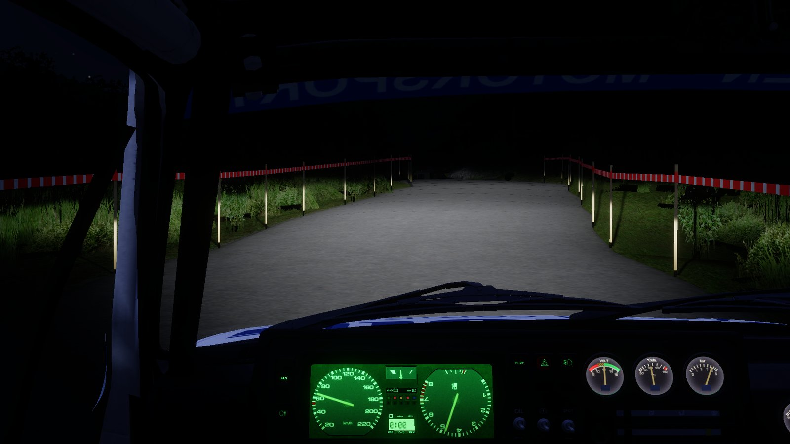
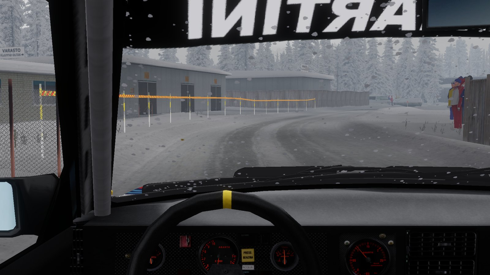
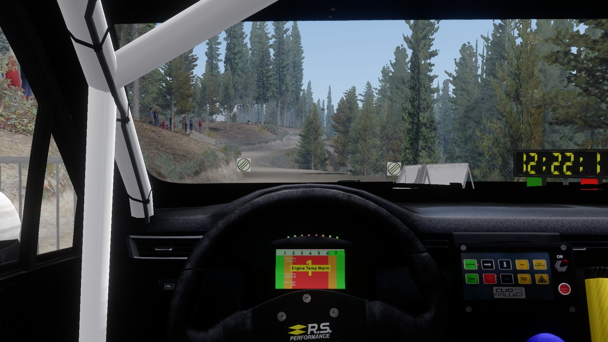
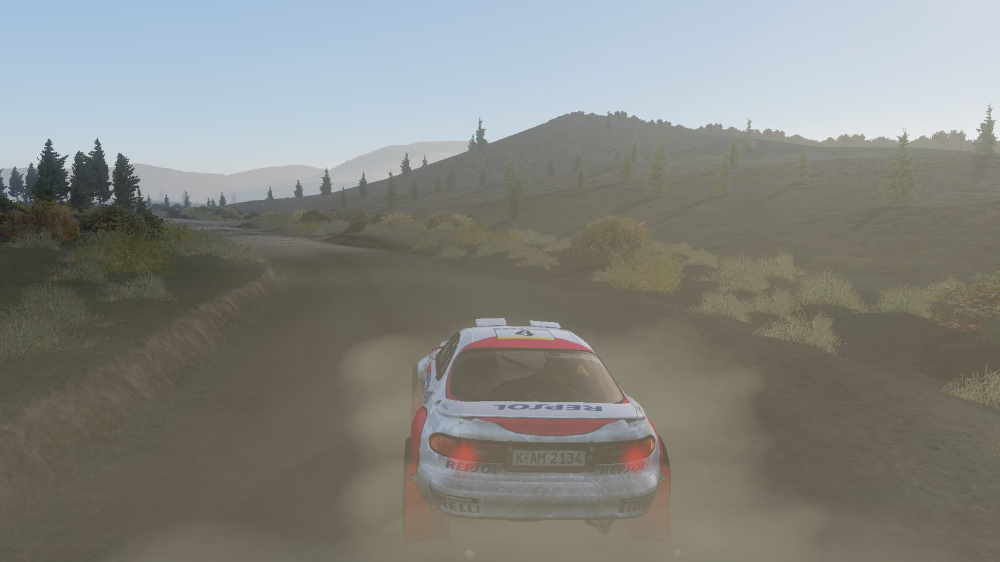
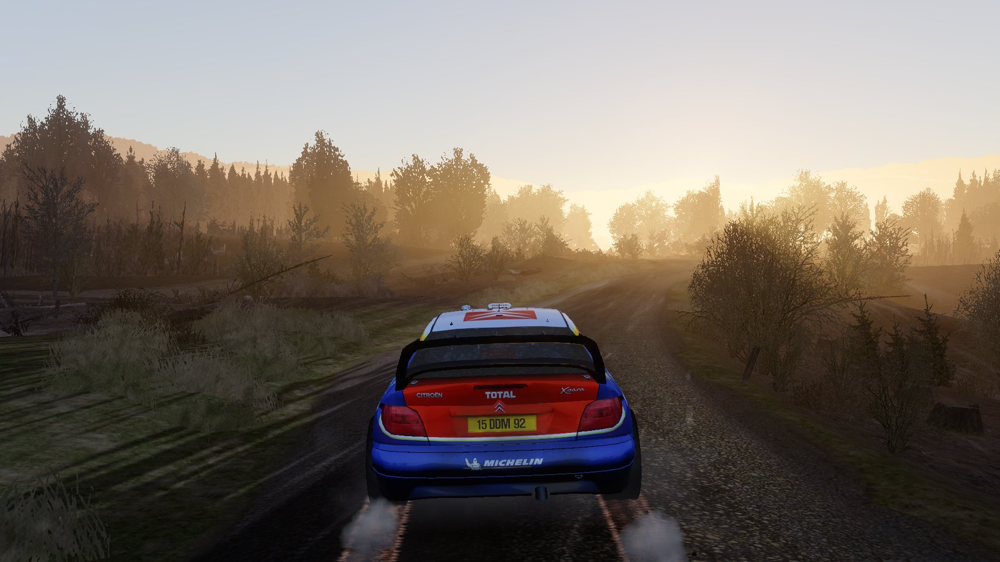
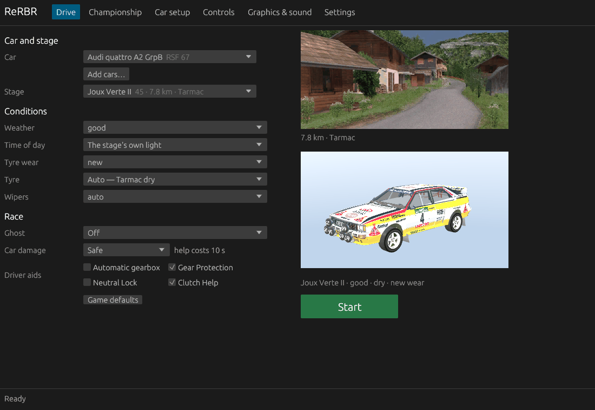
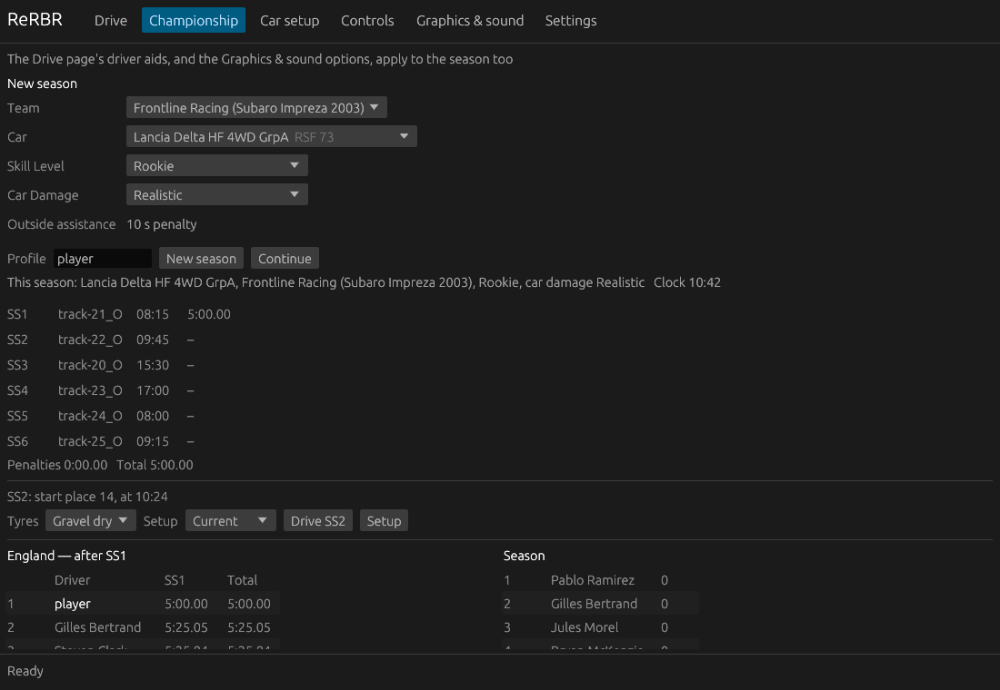

# ReRBR (WIP)

Reimplementation of Richard Burns Rally 1.02 with NGP 7 physics which can run natively on Linux and macOS (Windows
later). Everything you know and love + optional enhancements. Bring your own game files.

## Why

- **Native on Linux and macOS.** No Wine, no Proton, no Windows.
- **NGP 7 physics.** matched step by step against the original game running NGP.
- **The original game around it.** Weather, damage, the service park, the championship and the stage records work
  as in RBR 1.02, checked against recordings of the original.
- **The community's NGP cars and stages.** Point it at a RallySimFans install and its cars and stages are in the
  lists.
- **A modern look you can switch off.** A physically based sky and sun, HDR, sun shadows, rain and dust, a lit
  cockpit and working mirrors. Each addition has its own switch, so you can drive the original look too.

## Gallery

| | |
|---|---|
|  |  |
| Rain, wipers and a wet windscreen. Mitsubishi Lancer Evo IX N4 (model by KUBRT), Tanner, Japan | Night, by the headlights and the dial lights. VW Golf II GTI 16V (model by Ha3aP), Joux Verte II, France |
|  |  |
| Snow on the glass. Lancia Delta HF 4WD (model by kazuma_NARU), Kaihuavaara, Finland | A modern interior at the start. Renault Clio Rally3 (model by DMRally74), Mineshaft, Australia |
|  |  |
| Dust. Toyota Celica ST185 (model by gonzo_kool & kazuma_NARU), NewBobs, Australia | Low morning sun and haze. Citroen Xsara WRC 2006 (model by eddy3spain & rivers), Harwood Forest, UK |

The launcher. Left, the Drive page: the car, the stage and the conditions. Right, a championship season and its car.

| | |
|---|---|
|  |  |

## Status

Works today: every retail stage, the RallySimFans stages, the quick race and the championship, NGP physics with the
RallySimFans cars, the HUD and pace notes, the co-driver, sound, wheels and force feedback.

See the [known limitations](docs/playing.md#known-limitations) and
[what is the original and what is ours](docs/playing.md#what-is-the-original-and-what-is-ours).

## Install

### 1. Download ReRBR

The first release is not out yet: until then, [build from source](#build-from-source). Releases will be on the
[releases page](https://github.com/JodusNodus/rerbr/releases). Nothing else needs installing.

**macOS** (Apple silicon, macOS 11 or later): `ReRBR-<version>-macos.dmg`. Open it and drag ReRBR to Applications.
ReRBR isn't signed with an Apple Developer ID, so macOS refuses to open it the first time:
1. Open ReRBR. macOS says it cannot verify it: press **Done**.
2. Open **System Settings**, then **Privacy & Security**. Below Security it says "ReRBR was blocked…": press
   **Open Anyway** and confirm with your password.

After that it opens normally. (In Terminal, `xattr -dr com.apple.quarantine /Applications/ReRBR.app` does the same.)

**Linux** (x86_64 or ARM): `ReRBR-<version>-<arch>.AppImage`. Make it executable and start it:

```sh
chmod +x ReRBR-*.AppImage
./ReRBR-*.AppImage
```

It needs FUSE 2 or 3, which most desktops have. Without it, start it with `./ReRBR-*.AppImage
--appimage-extract-and-run`.

### 2. Your game, with NGP

ReRBR plays your own copy of Richard Burns Rally 1.02 with NGP 7. At the first start it asks for your game folder.
It looks in the usual places and offers the first install with NGP it finds. The folder can be:
- **A RallySimFans install.** This is the easiest: it has the game, NGP, and the community's cars and stages. The RSF
  installer is a Windows program, so install it on a Windows PC (or under Wine) and copy the whole
  `Richard Burns Rally` folder over.
- **RBR with the official 1.02 patch and the NGP plugin** from [gvrc.de](https://gvrc.de/NGP.html), copied over the
  same way.
- **Only the disc, and no Windows at all:** press **Set up from the disc…**. It builds the game folder from the disc
  image, the 1.02 patch and the NGP package. See [docs/install-from-disc.md](docs/install-from-disc.md).

ReRBR requires NGP 7.4.778's `NGP.dll`. Settings finds the RSF or game folder's `Plugins/NGP.dll` automatically;
if it is missing or a different version, use **Browse…** to select the 7.4.778 DLL from your NGP package.

ReRBR only reads the game folder. It never changes it.

### Build from source

You need Rust, through [rustup](https://rustup.rs), and SDL3: `brew install sdl3` on macOS. On Linux, your
distribution's SDL3 development package (for example `libsdl3-dev`), plus `pkg-config` and the ALSA and udev
development packages (for example `libasound2-dev` and `libudev-dev`).

```sh
git clone https://github.com/JodusNodus/rerbr.git
cd rerbr
cargo build --release
target/release/rerbr
```

This builds three programs in `target/release/`: `rerbr` (the launcher), `viewer` (the driving window) and
`rbr-standalone` (the physics). Start `rerbr`; it starts the other two. `cargo build --profile play` adds link-time
optimisation (a little faster, a slower build) and puts them in `target/play/`.

## Contributing

The original game is the oracle. We record drives in it, and every Rust port is checked against those recordings,
inside the original's own step, until it gives the same state bit for bit. NGP's physics is checked the same way
against the original running NGP. A C++98 reconstruction of the 1.02 binaries, in the separate rbr-recomp
repository, is how we read what the game computes.

Start with [docs/development.md](docs/development.md): the layout, the rules, the checks. The current state and the
open work are in [notes/status.md](notes/status.md). The recordings and physics records the tests check against are
published (`scripts/fetch-test-data.sh`), and CI runs every pull request against them. The snapshots of the original
are published too, so a new physics port can be checked inside the original's own step on your machine.

## Credits

ReRBR stands on the work of many people. Thank you.

**Richard Burns Rally.** Made by Warthog Games and published by SCi Games in 2004. In memory of Richard Burns
(1971-2005).

**NGP.** WorkerBee, for NGP (Next Generation Physics), the physics ReRBR drives with.
[gvrc.de](https://gvrc.de/NGP.html) hosts NGP and the NGP car packs.

**RallySimFans.** The team that keeps RBR alive, and every car and stage author whose work players drive. The
captions above credit the models shown.

**Plugins and projects we learned from.**
- RBRHUD by Towerbrah: the cockpit dials are drawn from its gauge data.
- RBRControls (Steven Lee, mika-n, Towerbrah, Detegr, RSWats): the H-shifter's clutch and rev-matching.
- [NGPCarMenu](https://github.com/mika-n/NGPCarMenu) by MIKA-N: its notes on the game's memory. Copyright (c) 2020
  by MIKA-N. All rights reserved. The full notice, which its licence asks us to keep, is in
  [`notes/references/ngpcarmenu/LicenseText.txt`](notes/references/ngpcarmenu/LicenseText.txt). NGPCarMenu in turn credits
  [Suxin](https://suxin.space/notes/rbr-play-replay/),
  [TheIronWolf](https://gitlab.com/TheIronWolfModding/rbrcrewchief) and the forum posts of WorkerBee, Kegetys,
  black f./jharron, Racer_S and Mandosukai.
- [RBRHshift](https://github.com/Menkaura81/RBRHshift3.5) (Racer_S, mod by Menkaura81).
- The [RBR track exporter for Blender](https://github.com/RichardBurnsRally/blender-track-exporter): the stage file
  formats and shader names.
- [rbr-setup-extractor](https://github.com/wbsth/rbr-setup-extractor) by wbsth.
- [openRBRVR](https://github.com/Detegr/openRBRVR) by Detegr.

## License

Copyright (C) the ReRBR authors. This program is free software: you can redistribute it and/or modify it under
the terms of the GNU General Public License as published by the Free Software Foundation, either version 3 of the
License, or (at your option) any later version. It is distributed in the hope that it will be useful, but WITHOUT ANY
WARRANTY; without even the implied warranty of MERCHANTABILITY or FITNESS FOR A PARTICULAR PURPOSE. See `LICENSE`.

Not covered: Richard Burns Rally itself, its binaries and its data, which are not in this repository and stay their
owners' property (bring your own copy).
