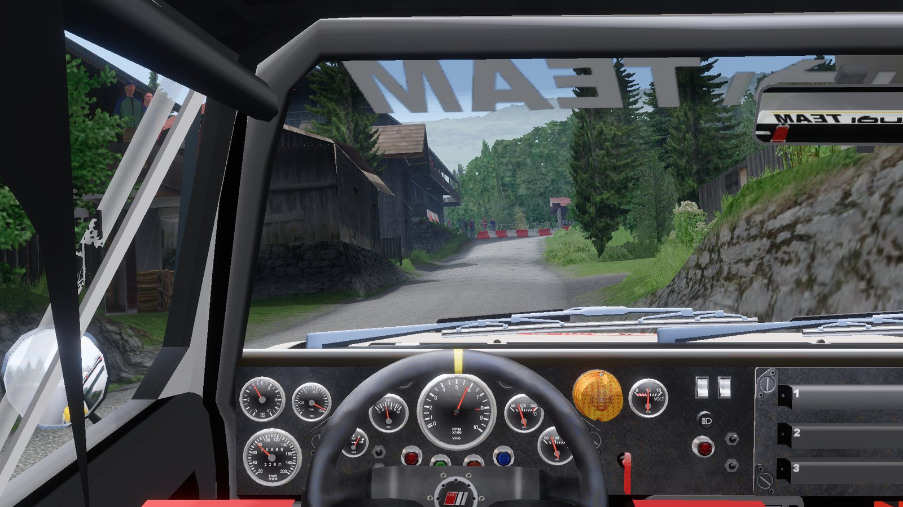
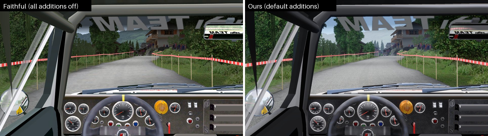

# ReRBR

Richard Burns Rally with NGP 7 physics, rebuilt in Rust to run natively on macOS and Linux. It is for rally sim
players who want RBR and its community cars and stages on their own computer, with a modern launcher and look, and
the handling they know. You bring your own game files.



*From the driver's seat: Audi quattro A2 (model by Shenshee) on Joux Verte II, France.*

## Why

- **Native on macOS and Linux.** Apple Silicon included. No Wine, no Proton, no Windows.
- **NGP 7 physics.** NGP 7.4.778, ported to Rust and checked step by step against the original game running NGP.
- **The original game around it.** Weather, damage, the service park, the championship and the stage records follow
  RBR 1.02's, checked against recordings of the original.
- **The community's NGP cars and stages.** Point it at a RallySimFans install and its cars and stages are in the
  lists.
- **A modern look you can switch off.** A physically based sky and sun, HDR, sun shadows, rain and dust, a lit
  cockpit. Each addition has its own switch, so you can drive the 2004 look too.
- **A launcher instead of the 2004 menus.** Searchable car and stage lists, the conditions, the championship, car
  setups and controls on simple pages.
- **Wheels, force feedback and H-shifters.** A wheel setup wizard, force feedback through SDL3 and an advanced
  H-shifter mode that grinds when you miss a shift.
- **Open source.** GPLv3. No original code runs: the programs read your own game files.

## Gallery

| | |
|---|---|
|  |  |
| Rain, wipers and a wet windscreen. Mitsubishi Lancer Evo IX N4 (model by KUBRT), Tanner, Japan | Night, by the headlights and the dial lights. VW Golf II GTI 16V (model by Ha3aP), Joux Verte II, France |
|  |  |
| Snow on the glass. Lancia Delta HF 4WD (model by kazuma_NARU), Kaihuavaara, Finland | A modern interior at the start. Renault Clio Rally3 (model by DMRally74), Mineshaft, Australia |
|  |  |
| Dust. Toyota Celica ST185 (model by gonzo_kool & kazuma_NARU), NewBobs, Australia | Low morning sun and haze. Citroen Xsara WRC 2006 (model by eddy3spain & rivers), Harwood Forest, UK |

The same frame with every addition off and with the defaults (the Audi quattro A2 on Joux Verte II): the cabin's
shade under the roof and the cage, and the sky through the glass.



The launcher: the Drive page with the car, the stage and the conditions, and a championship season with its car.

| | |
|---|---|
|  |  |

The driving shots were taken on a Mac at 1920x1080 on retail stages, with RallySimFans NGP cars and the launcher's default
additions. The car models are their authors' work, credited above; the cockpit dials are drawn from RBRHUD's data.

## Status

Works today: every retail stage, the RallySimFans stages, the quick race and the championship, NGP physics with the
RallySimFans cars, the HUD and pace notes, the co-driver, sound, wheels and force feedback.

Not yet, or not planned:
- **Windows** is planned, not available.
- **The original 2004 cars are not offered**: none of them has NGP physics.
- **The start and finish line animation** (the countdown marshal) does not play yet.
- **RSF cars use the retail Impreza's sound**; their own sound banks are not read.
- **Some RSF stages cannot be played**: RallySimFans encrypts them, and we do not decrypt them.
- **Left out on purpose:** replays, music, the rally school and the other extra modes.

The full lists: [known limitations](docs/playing.md#known-limitations) and
[what is the original and what is ours](docs/playing.md#what-is-the-original-and-what-is-ours).

## Install

On macOS or Linux. Everything after the build is in [docs/playing.md](docs/playing.md).

### 1. The game, NGP and the cars

You need three things. A RallySimFans (RSF) install has all three, so it is the easiest way.

**The game: Richard Burns Rally 1.02.** One of:
- **A RallySimFans install.** The RSF installer is a Windows program, so install it on a Windows PC (or under Wine) and
  copy the whole `Richard Burns Rally` folder over.
- **An installed copy of RBR with the official 1.02 patch**, copied over the same way.
- **The disc image and the 1.02 patch, with no Windows at all.** Once the launcher is built (step 4), its
  **Settings** page has **Set up from the disc…**, which builds the game folder from the disc image, the 1.02 patch
  and the NGP package. On the command line: `rbr-launcher --install-from-disc DISC PATCH NGP OUT`. See
  [docs/install-from-disc.md](docs/install-from-disc.md).

**NGP 7: the physics.** RSF includes it. Without RSF, install the NGP plugin package from
[gvrc.de](https://gvrc.de/NGP.html) into the game folder.

**The cars: NGP car packs.** RSF includes them. Without RSF, download a car's `NGP Physics` .zip and its `Model` .7z
from [gvrc.de](https://gvrc.de/NGP.html) (about 100 cars) into a folder, and press **Add cars…** in the launcher (or
run `rbr-launcher --add-cars DIR`). They go into `cars/` next to the launcher. The original 2004 cars are not
offered, because none of them has NGP physics.

The folder is only read, never written.

### 2. The tools

- Rust, through [rustup](https://rustup.rs).
- SDL3, for force feedback: `brew install sdl3` on macOS; on Linux your distribution's SDL3 development package (for
  example `libsdl3-dev`), plus `pkg-config` and the ALSA and udev development packages for sound and controllers (for
  example `libasound2-dev` and `libudev-dev`).

### 3. Build

```sh
git clone https://github.com/JodusNodus/rerbr.git
cd rerbr/rust
cargo build --profile play -p rbr-render -p rbr-standalone -p rbr-launcher
```

This makes `rbr-launcher`, `viewer` (the driving window) and `rbr-standalone` (the physics) in `rust/target/play/`.
The `play` profile is the release build with link-time optimisation; `--release` works too and puts them in
`rust/target/release/`.

### 4. Start

```sh
target/play/rbr-launcher
```

On the first start the launcher looks for the game in the usual places. If it doesn't find it, type the folder or
press **Browse…**. The **Settings** page shows what it found in the folder and what is missing.

### 5. A wheel

Open **Controls** and press **Set up your wheel**: it asks for the steering, the pedals, the paddles and the shifter
one at a time. The launcher opens on this page when it sees a wheel that has nothing bound yet. Force feedback and
the advanced H-shifter are on the same page.

### 6. Your files

Settings, bindings, records, ghosts and championship saves go next to the launcher, in the game's own formats
(records and ghosts under `NGP/`). The table is in
[docs/playing.md](docs/playing.md#where-your-files-go).

## Contributing

**How the project works.** The original game is the oracle: we record drives in it and replay them. A C++98
reconstruction of the 1.02 binaries, compared function by function with reccmp, is how we read what the game
computes; it is the behaviour reference and lives in a separate repository, rbr-recomp. The Rust code in `rust/` is
the product. Each Rust port is checked inside the original's own step, through an emulator, against those
recordings, and must give the same state bit for bit. NGP's physics is checked the same way against the original
running NGP.

**Layout.**
- `rust/` – the Rust workspace: `rbr-formats` (game file parsers), `rbr-physics` (physics), `rbr-gameplay`,
  `rbr-hybrid` (the checks inside the original's step), `rbr-standalone` (the physics program), `rbr-render` (the
  renderer and the driving window), `rbr-sound`, `rbr-launcher`, `rbr-recording`
- `harness/` – the runtime harness that runs our code inside the original game (`harness/README.md`)
- `notes/` – findings per system and file format
- `scripts/` – check, generator and analysis scripts

The full list is in [docs/development.md](docs/development.md#layout).

**Building and checks.** From `rust/`: `cargo test`. Before a merge, from the repository root:

```sh
RBR_DATA=<retail install> RBR_PATCH=<1.02 patch Main_group> RBR_RECORDINGS=<recordings> \
  scripts/rust-check.sh
```

It runs `cargo fmt --check`, clippy with warnings as errors, the tests and the physics vectors for the crates a
change touches. `RUST_CHECK_ALL=1` checks every crate; `RUST_CHECK_VECTORS=none` skips the vectors, which otherwise
need the vector store `RBR_VECTOR_STORE` names. `RBR_DATA` is the extracted retail 1.0 install and `RBR_PATCH` the
official patch's extracted `files/Main_group`; `RBR_NGP_PHYSICS` and `RBR_RSF` add the NGP and RSF tests. The tests
that need a variable skip when it is unset.

**Rules.**
- Game files are never committed: no binaries, data, RSF content or anything extracted from them.
- Physics and gameplay stay bit-exact against the original's recordings.
- Presentation (rendering, sound, HUD, launcher) never changes the physics: it only reads it.
- One module or crate per system; shared files such as `renderer.rs` or `live.rs` get small hooks only. Data parsers
  go in `rbr-formats`, one module per format, with a test over every retail file it covers.

**Open work** is listed per system in [`notes/progress/systems.md`](notes/progress/systems.md); the current state is
in [`LOG.md`](LOG.md).

**More:** [docs/development.md](docs/development.md) (how it fits together, the layout, the checks). The C++
reconstruction's matching workflow, reccmp and Ghidra are in the rbr-recomp repository.

## Credits

ReRBR stands on the work of many people. Thank you.

**Richard Burns Rally.** Made by Warthog Games and published by SCi Games in 2004. In memory of Richard Burns
(1971-2005).

**NGP.** WorkerBee, for NGP (Next Generation Physics), the physics ReRBR drives with.
[gvrc.de](https://gvrc.de/NGP.html) hosts NGP and the NGP car packs.

**RallySimFans.** The team that keeps RBR alive, and every car and stage author whose work players drive. The
captions above credit the models shown.

**Plugins and projects we learned from.**
- RBRHUD by Towerbrah: the cockpit dials are drawn from its gauge data.
- RBRControls (Steven Lee, mika-n, Towerbrah, Detegr, RSWats): the H-shifter's clutch and rev-matching.
- [NGPCarMenu](https://github.com/mika-n/NGPCarMenu) by MIKA-N: its notes on the game's memory. Copyright (c) 2020
  by MIKA-N. All rights reserved. The full notice, which its licence asks us to keep, is in
  [`notes/references/ngpcarmenu/LicenseText.txt`](notes/references/ngpcarmenu/LicenseText.txt). NGPCarMenu in turn credits
  [Suxin](https://suxin.space/notes/rbr-play-replay/),
  [TheIronWolf](https://gitlab.com/TheIronWolfModding/rbrcrewchief) and the forum posts of WorkerBee, Kegetys,
  black f./jharron, Racer_S and Mandosukai.
- [RBRHshift](https://github.com/Menkaura81/RBRHshift3.5) (Racer_S, mod by Menkaura81).
- The [RBR track exporter for Blender](https://github.com/RichardBurnsRally/blender-track-exporter): the stage file
  formats and shader names.
- [rbr-setup-extractor](https://github.com/wbsth/rbr-setup-extractor) by wbsth.
- [openRBRVR](https://github.com/Detegr/openRBRVR) by Detegr.

**Techniques.** The sky after Hillaire (EGSR 2020), the AgX tone curve after Sobotka (with Wrensch's polynomial fit),
and the ambient occlusion after GTAO (Jimenez et al. 2016).

**Libraries.** [wgpu and naga](https://github.com/gfx-rs/wgpu), [egui](https://github.com/emilk/egui),
[winit](https://github.com/rust-windowing/winit), [gilrs](https://gitlab.com/gilrs-project/gilrs), SDL3 through
[sdl3-sys](https://codeberg.org/maia/sdl3-sys-rs), [texpresso](https://github.com/jansol/texpresso),
[cpal](https://github.com/rustaudio/cpal), [lewton](https://github.com/RustAudio/lewton),
[hound](https://github.com/ruuda/hound), [zip](https://github.com/zip-rs/zip2) and
[flate2](https://github.com/rust-lang/flate2-rs), and [unshield](https://github.com/twogood/unshield) (MIT, Copyright
(c) 2003 David Eriksson), whose InstallShield reader the disc setup ports. The rest are in
[`rust/Cargo.lock`](rust/Cargo.lock).

The C++ reconstruction (rbr-recomp), our reference for the original's behaviour, is built with
[reccmp](https://github.com/isledecomp/reccmp) and Ghidra.

## License

Copyright (C) the ReRBR authors. This program is free software: you can redistribute it and/or modify it under
the terms of the GNU General Public License as published by the Free Software Foundation, either version 3 of the
License, or (at your option) any later version. It is distributed in the hope that it will be useful, but WITHOUT ANY
WARRANTY; without even the implied warranty of MERCHANTABILITY or FITNESS FOR A PARTICULAR PURPOSE. See `LICENSE`.

Not covered: Richard Burns Rally itself, its binaries and its data, which are not in this repository and stay their
owners' property (bring your own copy).
